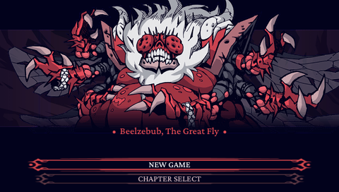
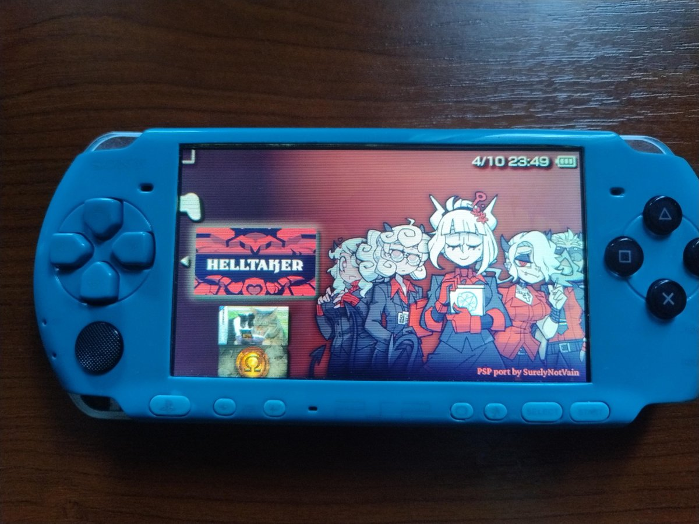
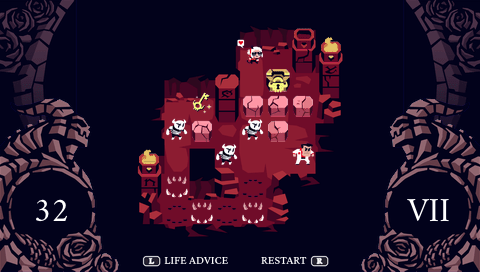
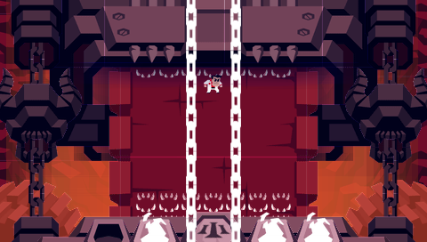
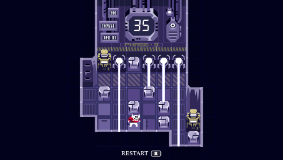
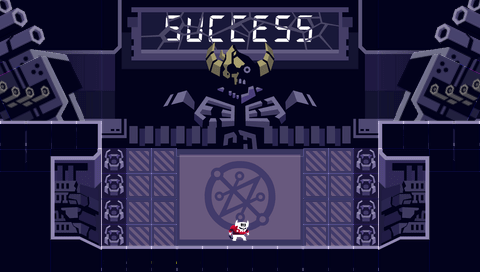
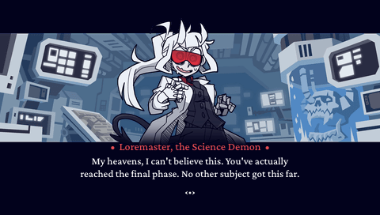

[](https://github.com/surelynotvain/helltaker-psp/releases/latest)
[](https://github.com/surelynotvain/helltaker-psp/releases/latest)

# Helltaker PSP



**Helltaker PSP** is a complete fan-made port (demake) of **Helltaker** and its free **Examtaker** bonus chapter for the Sony PlayStation Portable, by SurelyNotVain. It is PSP homebrew with its own engine written in C, packaged as a standard unsigned application for **ARK-4** and **ARK-5**.

The whole game is playable: all chapters, the Judgement boss fight, the epilogue and both endings, plus the free **Examtaker** bonus chapter with its lab floors and the final boss.

> [!NOTE]
> **Version 2.1 is my last update to Helltaker PSP.** The port is complete. From now on I will only release fixes for game-breaking bugs (crashes, a level that can't be finished, lost saves). Please report those through GitHub Issues. Translations are still welcome and will be added with credit.



*Running on a real PSP-3004: Helltaker PSP in the XMB Game menu.*

> [!IMPORTANT]
> This is an unofficial fan project. It is not affiliated with or endorsed by vanripper, Sony, the ARK developers, or the original Helltaker team.

## What's new in 2.1

### Fixes

- **Chapters V and VI can be finished again after the secret inscription.** Reading the inscription now leads straight into the demon's dialogue, as in the original. Before, the box was left in front of the demon and the level got stuck.
- **Lucifer's CEO entrance** now has her two skeleton guards, who step in on either side of her, timed to the original sound. She no longer fades in from transparent.
- **Examtaker's Loremaster** scene now shows Lucy the maid next to her.
- **Pause menu selection:** the selected row is now the wider one, with its brackets moving outward as in the original. Before, it was the other way round. The same fix applies to the language picker.

### Text

- **Text is now drawn by the PSP itself** from the game's fonts, instead of from pictures prepared on a PC. The letters are evenly spaced (no more "absolut e" or "You' ve"), with proper kerning, in English and in translations.
- `HT.PAK` is about 2 MB smaller (the text pictures are gone).
- Language packs are much smaller: the Polish pack went from 2.7 MB to 50 KB. Old language packs still work.

### Engine

The game now runs on **Vain's C Portable Engine 3.4**:

- **Loading screen.** Starting the game and changing levels now show a loading screen with a progress bar when the memory stick is slow, instead of a frozen picture.
- **Smoother frames.** The CPU prepares the next frame while the PSP's graphics chip draws the current one, and sprites are sent to the graphics chip in batches.
- **Safer saves.** Progress is written to `SETTINGS.BIN` with a backup copy (`SETTINGS.BIN.BAK`) and a checksum, so a save interrupted by a dead battery can't wipe your progress. Saves from 2.0 are carried over automatically.
- **Clear error screens.** A missing, incomplete or mismatched `HT.PAK` or `MUSIC.PAK` now shows a message that says what to copy, instead of a blank screen.
- **Performance overlay.** Hold SELECT to see the frame rate, update and draw times, and free memory.
- **PSP-1000 detection** and memory checks for the 32 MB model.
- The same controls as before: the same buttons, the same analog stick behaviour and the same anti-mash delay.

## What's included

### Main game

- Chapters I to IX with every demon, dialogue and both outcomes of each conversation
- Chapter X: the full Judgement boss fight with all four phases, the sin machine, the chains, the HP bar and the glorious success ending
- The epilogue at home, the pancake talks, the secret inscriptions, the ritual dance and the abyss ending
- Chapter select with every chapter you have reached
- The pause menu with the three ritual code panels that fill in as you find the inscriptions (also in the house: with all three found it shows the whole ritual path)
- Credits




### Examtaker

- The intro and the floor picker (start from the beginning or jump to any floor you have reached)
- Lab floors I to VI as Subject 67: lasers that crates and walls block, timed lasers, generators to break and the step counter on the lab monitor
- Floor VII: the Arch Mecha Demon boss with ground spike waves, laser volleys, cannon bombardments and the eraser beam, across all three phases
- The Examtaker door transition, the ending with Lucifer and the Examtaker credits





### Port features

- Built on **Vain's C Portable Engine** (VCPE), the PSP engine shared with the Awaria PSP port
- Native 480x272 presentation using the PSP's hardware renderer (GU)
- Text rendered on the PSP from the game's own fonts
- Language packs (`LANG.PAK`): play in English or in an installed translation, switchable at any time
- Original animations, dialogue portraits, music and sound effects
- Streamed music
- Loading screen with a progress bar
- Animated XMB icon (a chapter I speedrun) and XMB background music
- Progress is saved automatically (reached chapters, ritual pieces and Examtaker floors), with a backup copy
- One step per button press, with a short anti-mash delay so held or bounced buttons never take extra steps
- Works from Memory Stick and from PSP Go internal storage

## Languages

The game is in English. A language pack adds a translation of every dialogue, menu and prompt:

| Language | File | Translation |
|---|---|---|
| Polski (Polish) | `LANG-Polski.PAK` | Official Polish translation by vanripper ([Helltaker spolszczenie](https://vanripper.itch.io/helltaker-spolszczenie)) |

To install one:

1. Download the `LANG-....PAK` file from the release.
2. Copy it into `PSP/GAME/HelltakerPSP/` next to `EBOOT.PBP`.
3. Rename it to `LANG.PAK`.

With a language pack installed:

- At start-up the game asks for the language: ENGLISH or the translation (D-pad or analog stick, then X). It starts on your last choice.
- Press START in the main menu to choose the language again.
- The pause menu has a LANGUAGE row that switches between English and the translation instantly.

Without `LANG.PAK` the game is in English. Only one language pack can be installed at a time.

### Make your own translation

The [`translation`](translation/) folder has everything needed to build a `LANG.PAK` for any language from the PC game's text files: the `mklang.py` tool (Python 3 with Pillow and numpy) and a step by step guide, [`TRANSLATING.md`](translation/TRANSLATING.md). It contains no game text: it reads the English files from your own Helltaker install (free on Steam), and an existing translation of the PC game can be used as it is. Since 2.1 a language pack holds the translated text itself, so it stays small. Finished a translation? Share it through GitHub Issues so it can be added to a release, with credit.

## Requirements

- A PlayStation Portable that can run unsigned homebrew
- ARK-4, ARK-5 or another compatible custom firmware
- About 100 MB of free storage

Official firmware without a homebrew environment cannot launch this application.

## Download

Download the latest version from the **Releases** section of this repository. The easiest option is `HelltakerPSP.zip`, which already contains the folder to copy.

## Installation

The game folder must contain all three files:

```text
HelltakerPSP/
  EBOOT.PBP
  HT.PAK
  MUSIC.PAK
  LANG.PAK      (optional, a language pack)
```

Copy the complete `HelltakerPSP` folder to:

```text
ms0:/PSP/GAME/HelltakerPSP/
```

For PSP Go internal storage, use:

```text
ef0:/PSP/GAME/HelltakerPSP/
```

Then open the Game menu on the PSP and launch **Helltaker PSP**.

> [!WARNING]
> Do not copy `EBOOT.PBP` on its own. `HT.PAK` holds the graphics, fonts and sound effects and `MUSIC.PAK` holds the music. Both must stay in the same folder as the EBOOT, and all files must come from the same release.

## Updating

1. Exit the game.
2. Replace `EBOOT.PBP`, `HT.PAK` and `MUSIC.PAK` in `PSP/GAME/HelltakerPSP/` with the files from the new release.
3. Keep `SETTINGS.BIN` (and `SETTINGS.BIN.BAK`) if they are there. They are your save file (progress and settings).

Version 2.1 changed `EBOOT.PBP` and `HT.PAK` (`MUSIC.PAK` is unchanged since 1.3). Language packs belong to the game version they were released with: when you update the game, also download the language pack again from the same release.

## Controls

| Button | Action |
|---|---|
| D-pad or analog stick | Move one tile per press, navigate menus |
| Cross (X) | Confirm, advance dialogue |
| Circle (O) | Back |
| START | Pause menu (in the main menu: choose the language, when a language pack is installed) |
| R or Square | Restart the level |
| L or Triangle | Life advice (hint) |
| SELECT (hold) | Performance overlay |
| HOME | PSP exit menu |

Movement is turn based. Each press moves one tile, so release the direction before the next step.

## Compatibility

| Environment | Status |
|---|---|
| ARK-4 | Supported |
| ARK-5 | Supported |
| PSP-1000 | Supported (standard memory layout, no expanded memory needed) |
| PSP-2000 / 3000 / Street | Supported (playtested on a PSP-3004) |
| PSP Go Memory Stick | Supported |
| PSP Go internal storage | Supported through `ef0:` |

The whole game, including Examtaker, was playtested on a real PSP-3004 up to version 2.0. Version 2.1 was tested in the PPSSPP emulator, including the PSP-1000 memory layout. If something in 2.1 breaks the game on your console, please report it.

## Troubleshooting

### The game does not appear in the Game menu

The folder structure must be exactly:

```text
PSP/GAME/HelltakerPSP/EBOOT.PBP
```

Avoid an extra nested folder such as `PSP/GAME/HelltakerPSP/HelltakerPSP/EBOOT.PBP`.

### An error screen at start-up

The message says which file is missing or doesn't match. Copy `EBOOT.PBP`, `HT.PAK` and `MUSIC.PAK` again, all from the same release. `HT.PAK` is about 26 MB and `MUSIC.PAK` about 71 MB.

### No music

Make sure `MUSIC.PAK` is in the same folder as `EBOOT.PBP` and was copied completely. Keep the file names in upper case.

### Music stutters

Slow or damaged storage can interrupt streamed audio. Try copying the game again, using another Memory Stick or disabling plugins.

### The game returns to the XMB

1. Check that all three files were copied completely.
2. Update ARK to a recent version.
3. Launch the game directly from the XMB.
4. Temporarily disable game related plugins.
5. Try another Memory Stick if you have one.

## Reporting bugs

From 2.1 on only game-breaking bugs will be fixed. Reports through GitHub Issues should include:

- PSP model
- ARK version
- Installation path (`ms0:` or `ef0:`)
- Active plugins
- The chapter or floor and what you were doing
- Steps to reproduce the problem
- A photo or video if the problem is visual

## Source code

- [`engine`](engine/): the source code of the game (`engine/src`) and of Vain's C Portable Engine 3.4 (`engine/vcpe/src`). See [`engine/README.md`](engine/README.md).
- [`translation`](translation/): the language pack tools.

Game assets, converted game data and the data conversion tools are not included.

Please do not redistribute modified releases under the same name without clearly marking them as unofficial modifications.

## Credits

- **Helltaker** and **Examtaker** were created by **vanripper** (Łukasz Piskorz).
- Sound design by Patryk Karwat. Music by Mittsies.
- PSP homebrew development is supported by the PSPSDK and pspdev communities.
- ARK compatibility is thanks to the ARK community and its contributors.
- Polish translation: the official translation by vanripper.
- Fonts: Crimson Pro (The Crimson Pro Project Authors), Amiri (Khaled Hosny) and Segment7 (Cedric Knight), all under the SIL Open Font License 1.1 (see `translation/langkit/fonts/OFL.txt`).
- PSP port by SurelyNotVain and Taliayaya.

All original Helltaker names, characters, artwork, music and related assets belong to their respective creators and rights holders. Helltaker is free on Steam; please support the original creator.

## Disclaimer

This project is provided for educational, preservation and entertainment purposes. It is not an official release and comes without any warranty. The developers of this port are not responsible for data loss, storage corruption, console damage or problems caused by firmware modifications or third party plugins.

## AI disclosure

AI tools are used directly in the development of **Vain's C Portable Engine** (VCPE), the PSP engine in [`engine/vcpe`](engine/vcpe/). They are not used to make the demakes themselves: the Helltaker PSP game is not AI-made.
